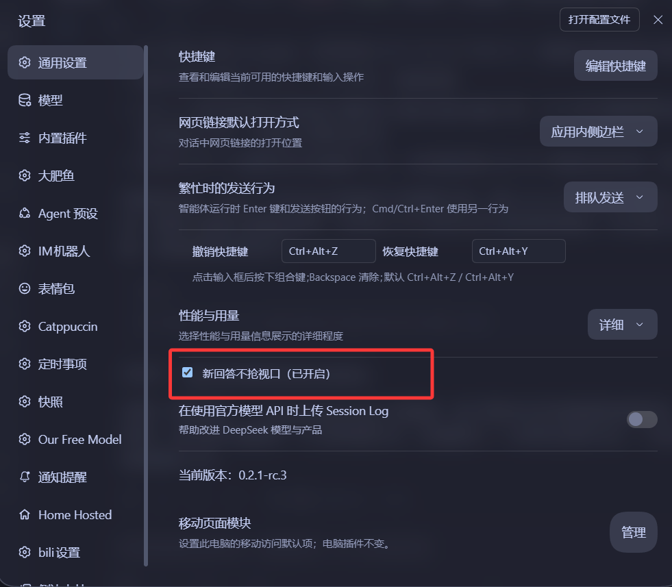

# dsh-chat-answer-anchor

关掉 DSH 聊天区的**自动贴底滚动**：新回答出现时视口不再自己往下跑，你想什么时候往下读就自己滚；发消息之后仍会先帮你到底，好让你看见自己刚发的话。

## 解决什么问题

DSH 默认的滚动策略是「贴底跟随」：只要没主动往上滚，任何新内容出现都会把视口拉到底部。
结果是一段长回答还在生成，屏幕就一直往下跑，你被迫一路追着它滚，或者等它写完再手动滚回开头。

装上这个插件之后：视口**冻结**在你最后停留的位置。新内容往下长、DSH 想把视口拽到底，都会被拉回原处；只有你自己发消息时，它才先帮你滚到底看一眼自己发的话。

## 行为细节

- **你滚到哪儿就停在哪儿**：滚轮、触摸、点击、翻页键、空格都算你在动，位置跟着你走，插件不抢。生成过程中也一样——想往上翻随时能翻。
- **发消息之后先跟到底**：自己发出去的话要能看见。DSH 只在「本来就在跟随底部」时才自动贴底，你要是往上翻着发的，它一声不吭——所以插件自己动手滚到最下方，这段完全不拦。
- **回答一开始出字就锁住**：不等「位置静止」那种判据（流式输出一直在长高，永远等不到），只要最后一条提问后面冒出回答内容，立刻收手冻结，之后长多高都不动。
- **自己滚动的意图被尊重**：手势之后一段时间内的位移都算你自己滚的，不会被当成「被拽走」。
- **拦下自动贴底**：在没有手势的情况下视口被往下拽，立刻拉回，并顺手把 DSH 的「跟随底部」关掉。拉回本身有限速（120ms 一次），免得跟 DSH 每帧抢 `scrollTop` 把页面拖卡。
- **内容变短不硬撑**：内容缩短导致滚动位置被浏览器夹回去时，接受新位置，不会反复往上顶。
- **每个会话各记各的位置**：切到别的会话再切回来，回到你上次停的地方，不会串。切过去时内容还没渲染完也不会认输，会等它长够再对齐。
- **刷新页面位置还在**：位置按会话存进 `sessionStorage`，页面重载后回来还能接上。
- **完全不碰输入框**：只动滚动位置，不改布局、不写内边距；在输入框里打字、点输入框都不算「想滚页面」。
- **可以随时关掉**：设置 → 通用 → 「新回答不抢视口」一行开关，关掉后插件完全停止接管，刷新页面也记得你的选择。

## 兼容性

纯客户端插件，不替换、不劫持 DSH 自带的聊天视图组件，只旁路观察它渲染出来的 DOM：

- 滚动容器：`[data-conversation-scroll]`
- 会话 id：滚动容器祖先上的 `[data-conversation-session]`
- 轮次行：`[data-chat-turn="<数字>"]`
- 跟随状态：`[data-chat-following-tail]`

这些选择器集中在 `lib/client.js` 顶部的 `SELECTORS` 里，DSH 改名字时只用改这一处。
万一一个滚动容器都找不到（说明 DOM 结构变了），控制台会打一条警告，不会静默失效。

宿主侧没有任何服务、路由或持久化，`lib/index.js` 是空实现。

## 诊断面板

`lib/client.js` 顶部有 `SHOW_PROBE` 开关，**当前为 `false`（已关闭）**。改成 `true` 会在右下角显示四行状态：

```
冻结 v15 · 容器 1 · 行 16 · 会话 3f2a9c1d
rest 1200 cur 1200 max 3400
tail 0 跟 0 拦 3 催 1
user 9
拦下贴底
```

- `会话` 是当前滚动容器所属的会话 id 前 8 位
- `rest` 记住的位置，`cur` 当前位置，`max` 最大可滚值
- `tail` 是否还处在「跟随底部」状态，`跟` 是否处在「发送后跟随」的放手期
- `拦` 拉回次数，`催` 补发 scrollend 的次数
- `user` 当前识别到的用户消息行数
- 最后一行是最近一次动作原因

排查问题时改回 `true`，改完重新加载页面即可，不需要改别的地方。

## 项目结构

```
dsh-chat-answer-anchor/
├─ lib/
│  ├─ index.js          宿主侧入口（空实现，纯客户端插件）
│  └─ client.js         全部逻辑：冻结视口、发送后跟随、会话记忆、设置开关
├─ test/
│  ├─ selftest.mjs      静态自测：模拟 __ModuleLoader__ 校验导出与注册参数
│  ├─ behav.mjs         行为自测：假 DOM 跑 91 条断言
│  └─ bench.mjs         微基准：量热路径开销
├─ docs/screenshots/    插件市场用的截图
├─ screenshots.json     截图清单（DSH 插件市场读取）
├─ cordis.patch.yml     bundle 插入声明
└─ package.json
```

## 截图

设置 → 通用 里的开关：



## 开发与自测

```bash
npm run check   # 语法检查（node --check 两个入口）
npm test        # 静态自测 + 行为自测
npm run bench   # 热路径微基准
```

## 安装

```bash
# 从 GitHub 安装
dsh plugin --profile web add github:arcnapan/dsh-chat-answer-anchor

# 或者在 DSH 里用本地路径安装
# plugin_manager install_bundle /absolute/path/to/dsh-chat-answer-anchor
```

安装后需要**完全退出并重新打开** DSH（Desktop 版关窗口可能只是隐藏，进程还在跑）。

## English

Freezes the scroll position of the DSH chat pane. New replies no longer drag the viewport
to the bottom — it stays where you left it, and you scroll when you want to.

Works by watching the rendered chat DOM from a `shell.overlay` slot: gestures are followed,
unprompted downward drift is pulled back and a synthetic `scrollend` turns off DSH's
follow-the-bottom mode. Each session remembers its own position; the toggle lives in
Settings → General.

## 许可

MIT
